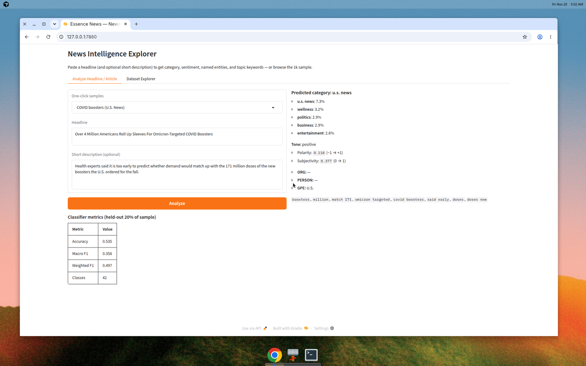
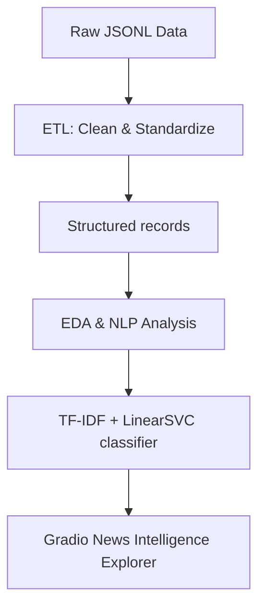

# Essence News — News Intelligence Explorer

[](https://huggingface.co/spaces/waleedarif1011/essencenews)
[](https://github.com/waleedarif1011/essencenews/actions/workflows/ci.yml)
[](LICENSE)

End-to-end NLP portfolio project: ETL → sentiment / NER / TF-IDF keywords → lightweight headline category classifier → interactive **News Intelligence Explorer**.

> **Live demo:** Space URL above goes live after deploy (`./scripts/deploy_hf_space.sh` — needs `HF_TOKEN`). Until then, run locally with `python app.py`.




## Quickstart

```bash
python -m pip install -r requirements.txt
python -m src.train_classifier   # writes artifacts/category_model.joblib (if needed)
python app.py                    # News Intelligence Explorer (Gradio)
```

`requirements.txt` pins `en-core-web-sm`, so a separate `spacy download` step is not required.

Optional — download the full ~210k-row HuffPost JSONL:

```bash
python scripts/download_data.py
```

## Classifier metrics

Trained on the stratified 1k sample (80/20 holdout, 42 categories):

| Metric | Value |
|--------|-------|
| Accuracy | 0.535 |
| Macro F1 | 0.358 |
| Weighted F1 | 0.497 |
| Train / test rows | 800 / 200 |

## App features

1. **Analyze Headline / Article** — predicted category (top-k scores), sentiment polarity/subjectivity, named entities (ORG / PERSON / GPE), topic keywords. Four one-click sample headlines included.
2. **Dataset Explorer** — category distribution, mean sentiment by category, and top entities from `sample_news_1k.jsonl`.

## Pipeline



## Tests & CI

```bash
python -m pytest -q
```

GitHub Actions runs install → train → pytest on every push/PR to `main`.

## Deploy (Hugging Face Space)

This repo is Space-ready (`app.py` + Gradio README frontmatter). With a write token:

```bash
export HF_TOKEN=hf_...   # https://huggingface.co/settings/tokens (Write + Spaces)
./scripts/deploy_hf_space.sh
```

The script creates `waleedarif1011/essencenews` if missing, uploads runtime files, and prints the Space HTTP status. Manual steps: [`docs/hf-space-deploy.md`](docs/hf-space-deploy.md).

## Project layout

```
app.py                      # Gradio News Intelligence Explorer
src/
  etl.py                    # load & normalize JSONL
  nlp.py                    # TextBlob sentiment, spaCy NER, TF-IDF / LDA
  train_classifier.py       # TF-IDF + LinearSVC category model
  analyze.py                # single-article orchestration
dataset/sample_news_1k.jsonl
artifacts/category_model.joblib
artifacts/metrics.json
assets/                     # README screenshots (Analyze + Explorer)
notebooks/news_analysis.ipynb
scripts/deploy_hf_space.sh  # HF Space create + upload
scripts/download_data.py
tests/test_nlp.py
```

Large intermediates (`News_Category_Dataset_v3.json`, `etl_output.csv`, `structured_output.jsonl`) are gitignored — regenerate locally via the download script + notebook / `src.etl`.

## References

- [HuffPost News Category Dataset](https://www.kaggle.com/datasets/rmisra/news-category-dataset)
- [spaCy](https://spacy.io/) · [TextBlob](https://textblob.readthedocs.io/) · [scikit-learn](https://scikit-learn.org/) · [Gradio](https://www.gradio.app/)

## Author

**Waleed Arif** — Data Scientist

## License

MIT — see [`LICENSE`](LICENSE).
